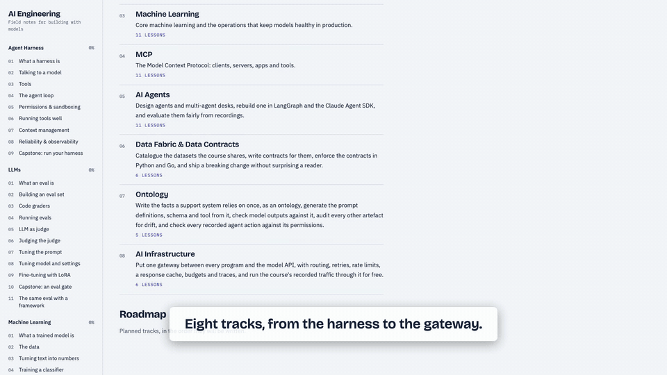

# AI Engineering

An interactive masterclass on building AI systems, taught with real, runnable code in Python and Go. Eight tracks and 70 lessons take one support product, Lumen, from a single model call to a multi-agent desk behind a gateway, with the data contracts and the ontology that keep every part honest.

The interactive site is in this repository: `cd app && npm install && npm run dev` serves it locally, and `npm run package` builds it as a single page. The code, the lessons as MDX, the data and the tests are all here.

## What

| # | Track | Lessons | What you build |
|---|---|---|---|
| 1 | Agent Harness | 9 | The loop, tools, context handling and guardrails around a model, in one file per language. |
| 2 | LLMs | 11 | An eval lab for ticket triage: eval sets, code graders, a judge, prompt tuning, LoRA, the same eval in Inspect. |
| 3 | Machine Learning | 11 | A classic text classifier on real complaints, then tracking, a registry, serving, drift monitoring and retraining. |
| 4 | MCP | 11 | Two Model Context Protocol servers, clients, auth, an App and an agent, in Python and Go. |
| 5 | AI Agents | 11 | Agent patterns and a multi-agent desk in three engines, a record/replay proxy, and fair evals. |
| 6 | Data Fabric & Data Contracts | 6 | A catalogue of the course's datasets, contracts with twin validators, and a breaking change shipped under contract. |
| 7 | Ontology | 5 | Lumen's facts written once, the prompt definitions, schema and tool generated from them, and an audit of every artefact. |
| 8 | AI Infrastructure | 6 | A gateway between every program and the model API: routing, retries, a cache, budgets and traces, replayed on recorded traffic. |

Every lesson follows the same shape: the concept, a stepping diagram or an interactive aid, the code with Python and Go tabs, a try-it you can run, and a quiz. The lessons' numbers come from scripts in this repository and are pinned by tests.

## Why

- **Real code, not slides.** Every track is a working program you can run, read and change; the lessons quote it by numbered section.
- **Recorded once, replayed free.** Model calls are recorded with an estimate and an explicit yes, then replayed byte for byte, so every lesson and every test runs offline at no cost.
- **Every number is pinned.** Each figure on each page is read from a derived file that a script writes and a test checks, so the course cannot drift from its own data.
- **Gates that mean something.** Each capstone ends in a gate that is green or red on purpose, and the lesson says what the gate proves and what it does not.
- **Twins where they matter.** Python first; Go twins of the harness, the lab, the servers, the desk, the validator and the gateway, equal on shared tests.

## The demo



The full captioned demo (about two and a half minutes, 1080p, silent) is produced from the packaged site by `cd app && npm run demo`; the poster and the teaser above come from `node scripts/demo/media.mjs`. See [docs/site.md](docs/site.md).

## Quick start

```sh
git clone https://github.com/lavrut/ai-engineering.git && cd ai-engineering
cd app && npm install && npm run dev            # the site, at the address Astro prints
python3 -m venv .venv-harness && .venv-harness/bin/pip install -r harness/python/requirements.txt   # one venv per track, at the repo root
```

Each track has its own venv and its own page of commands under `docs/tracks/`. Nothing in the repository calls a model unless you pass a recording flag, approve the printed estimate, and supply a key for that one command.

## Layout

```
app/        the Astro site (lessons, diagrams, aids, quizzes) and the demo-video pipeline
harness/    track 1, Python and Go          llms/       track 2, the eval lab, LoRA, Inspect
ml/         track 3, train, serve, monitor  mcp/        track 4, servers, clients, auth, the App
agents/     track 5, proxy, desks, evals    data/       track 6, contracts, catalogue, validators
ontology/   track 7, lumen.yaml and tools   infra/      track 8, the gateway and its Go twin
docs/       how to run each track, the site, the style guide, the specs and plans each track was built from
```

## Documentation

- Running and testing each track: [harness](docs/tracks/harness.md) · [LLMs](docs/tracks/llms.md) · [ML](docs/tracks/ml.md) · [MCP](docs/tracks/mcp.md) · [AI Agents](docs/tracks/agents.md) · [Data](docs/tracks/data.md) · [Ontology](docs/tracks/ontology.md) · [AI Infrastructure](docs/tracks/infra.md)
- The site: building, packaging, publishing, adding a lesson, the demo video: [docs/site.md](docs/site.md)
- How lessons are written: [docs/STYLE.md](docs/STYLE.md)
- Design specs, plans and the rulings made while building each track: `docs/superpowers/`
- Dataset notes: [llms/data](llms/data/README.md) · [ml/data](ml/data/README.md) · [mcp/data/recordings](mcp/data/recordings/README.md) · [agents/data/recordings](agents/data/recordings/README.md) · [data/fixtures](data/fixtures/README.md)

## Tests

Over 4,000 tests across the site (Vitest), the eight tracks (pytest, one venv each) and the Go twins (`go test`). Each track's page under `docs/tracks/` lists its commands; the site's are in [docs/site.md](docs/site.md).

## License

MIT. See [LICENSE](LICENSE).
